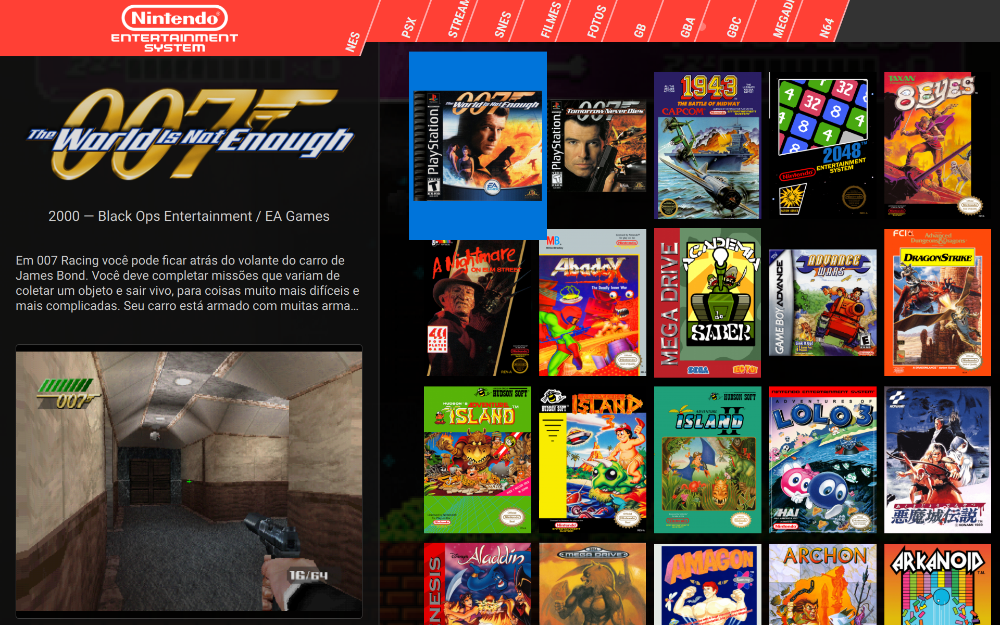

# Portal Retro TV

Scripts e painel leve para transformar um PC antigo com Linux Mint em uma central de entretenimento para a TV da sala: **jogos retrô, filmes, streaming e galeria de fotos**, navegáveis apenas com controles USB.

Validado em hardware modesto (**Core 2 Duo E8500, 5,7 GB de RAM e GeForce 210**).



## O que o portal faz

| Guia | O que abre | Como funciona |
| :--- | :--- | :--- |
| Jogos retrô (NES, SNES, Mega Drive, PS1, N64, GB/GBC/GBA) | Jogo no RetroArch | Pegasus Frontend + cores libretro |
| Filmes | Biblioteca Jellyfin e HBO Max | Jellyfin / Chrome kiosk |
| Streaming | Netflix, YouTube, Disney+, Prime Video, Globoplay | Chrome kiosk (Widevine) |
| Fotos | Biblioteca de fotos no Jellyfin | Jellyfin |

- Login automático e abertura do **Pegasus Frontend** em tela cheia.
- Suporte a dois controles USB configurados de forma simétrica.
- Combinação **Select + Start** encerra o jogo ou navegador e retorna ao portal.
- Capas, descrições e metadados gerados por script a partir dos `gamelist.xml`.
- Painel web simples de monitoramento (porta `8088`) e acesso remoto opcional via VNC na rede local para manutenção.

## Arquitetura

```text
Login automático (LightDM)
        └── Pegasus Frontend (Flatpak, tela cheia)
              ├── Jogos ──► retroarch -L <core> <rom>
              └── Apps ───► portal-abrir "<Nome>" ──► Chrome kiosk
                                                      └── portal-saida.py (Select+Start fecha)
```

## Estrutura do Repositório

```text
portal/      scripts numerados na ordem de execução
otimizar/    limpeza opcional de serviços e desktop
painel/      painel web de status em Python + HTML
fotos/       localizador de fotos duplicadas (somente leitura)
docs/        problemas resolvidos, melhorias planejadas e imagens
```

## Requisitos

- Linux Mint 22 (ou Ubuntu/Debian equivalente), RetroArch, Flatpak, Google Chrome e Jellyfin.
- ROMs e BIOS próprias organizadas em `/homelab/RomM/library/roms/<sistema>/` com `gamelist.xml`. **Este repositório não inclui ROMs, BIOS nem capas.**
- Tema [pegasus-theme-grid](https://github.com/mmatyas/pegasus-theme-grid) clonado em `/opt/portal-retro-tv/temas/pegasus-theme-grid` (respeite a licença original).

## Instalação

Os scripts assumem o repositório em `/opt/portal-retro-tv` e um usuário dedicado `portal` com autologin. Ajuste as variáveis no topo de cada script caso utilize outros nomes ou faixas de rede.

```bash
sudo git clone <URL_DO_REPOSITORIO> /opt/portal-retro-tv
cd /opt/portal-retro-tv/portal
sudo bash 1-remover-romm-e-instalar-emuladores.sh   # RetroArch + cores
python3 2-gerar-colecoes.py                         # coleções iniciais
sudo bash 3-acesso-remoto.sh                        # VNC na rede local (opcional)
sudo bash 4-finalizar-portal.sh                     # Pegasus, autostart e portal-abrir
sudo bash 5-adicionar-hbomax.sh
sudo bash 6-ajustar-retroarch.sh                    # tela cheia e pasta de BIOS
sudo bash 7-copiar-controle-p2.sh                   # replica mapeamento do controle 1 no controle 2
sudo bash 8-atalho-sair-retroarch.sh                # atalho Select+Start
sudo python3 9-capas-e-guias.py                     # capas, filmes, streaming e fotos
sudo bash 11-tema-familia.sh                        # tema com ícones das guias
```

Após executar a sequência, reinicie a máquina. *(O script `10` foi descartado durante os testes de tema e não faz parte da instalação.)*

## Limitações Conhecidas

- A GPU GeForce 210 decodifica apenas **H.264** em hardware.
- Serviços de streaming com DRM (Widevine) operam em até **720p** em navegadores Linux.
- O Google Chrome foi escolhido por apresentar melhor compatibilidade com Widevine do que o Firefox no ambiente testado.
- Emuladores de PS1 e N64 dependem de BIOS próprias e podem apresentar limitações de desempenho em CPUs mais antigas.

## Licença

[MIT](LICENSE)
